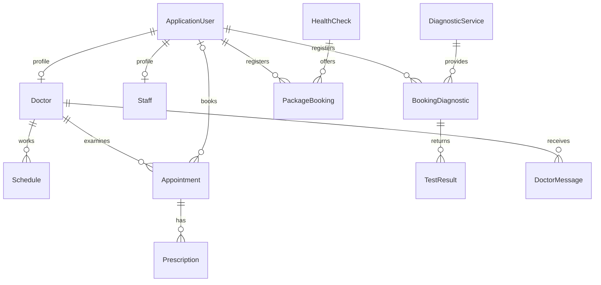

# Báo cáo chuyển đổi và kiểm chứng

Ngày thực hiện: 15/10/2026. Đích: thư mục Hospital-Management, cạnh mã nguồn Laravel.

## Kiến trúc

| Thư mục / File | Vai trò |
|---|---|
| HospitalManagement.sln | Solution Visual Studio gồm MVC web và test |
| Models, Models/ViewModels | Entity, validation và dữ liệu nhập từng màn hình |
| Data/ApplicationDbContext.cs | IdentityDbContext, quan hệ, index, decimal(18,2) |
| Data/DbInitializer.cs | Migration, nhập dữ liệu gốc theo giao dịch, seed Development |
| Controllers | Trang công khai, tài khoản, đặt khám/xét nghiệm/gói khám, hồ sơ |
| Areas/Admin, Doctor, Diagnostic, Staff | Controller và Razor View theo phân hệ |
| Services | Đặt lịch, quyền xem hồ sơ, PDF, mật khẩu cũ và email |
| wwwroot | Bootstrap, CSS, JavaScript và banner cục bộ |
| Migrations | Code First và snapshot EF Core |

Ứng dụng sử dụng MVC thực: Controller tiếp nhận yêu cầu, EF Core đọc/ghi SQL Server, Razor View render HTML trên máy chủ. Không phụ thuộc Laravel, Inertia, Vue SPA hoặc Vite.

## Những điểm đã sửa so với hướng dẫn gốc

Tài liệu chưa kiểm chứng được giữ nguyên trong `HUONG_DAN_CHUYEN_DOI_GOC.md`.

| Thiếu sót / Rủi ro | Cách xử lý |
|---|---|
| NuGet không chốt phiên bản | .NET 8, EF Core/Identity 8.0.28, EF tool local |
| User.Role trùng nguồn dữ liệu Identity | Chỉ sử dụng Identity Roles |
| Thiếu entity và chức năng | Có Staff, PackageBooking, BookingDiagnostic, TestResult, News, DoctorMessage |
| Bind entity có navigation/giá/trạng thái | Dùng ViewModel, lấy giá/trạng thái/chủ sở hữu phía máy chủ |
| Ngày giờ/thứ lưu text, slot viết cứng | DateOnly, TimeOnly và slot sinh từ ca bác sĩ |
| STT=count+1, không kiểm tra trùng | SQL Serializable, khóa bác sĩ, unique index slot, STT=max+1 kể cả lịch hủy |
| Bác sĩ thấy tất cả bệnh nhân | Lọc Doctor.UserId từ tài khoản hiện tại trong GET và POST |
| Xem phiếu qua ID tăng dần | Kiểm tra chủ sở hữu/vai trò; khách dùng token ngẫu nhiên 256 bit |
| Ghi đè trạng thái/đơn thuốc | rowversion; kê đơn và hoàn tất trong một SaveChanges |
| Thiếu cấu hình FK SQL Server | Restrict quan hệ nghiệp vụ, giữ cascade đúng cho Identity |
| Hash Laravel không tương thích | Kiểm tra BCrypt, nâng cấp sang hash Identity khi đăng nhập |
| Tiền tệ không nhất quán | Snapshot đơn vị BDT/VND; dashboard nhóm theo đơn vị |
| Không có kiểm chứng | Migrations, test SQL Server thật, build CLI và Visual Studio |

## Tuyến chính và phân quyền

| Phân hệ | Tuyến |
|---|---|
| Công khai | /, /Home/Doctors, /Home/Doctor/{id}, /Home/News, /Home/Article/{id}, /Home/About |
| Tài khoản | /Account/Login, Register, Profile, Password, ForgotPassword, ResetPassword |
| Đặt lịch / hồ sơ | /Appointment/Book, /Appointment/Details/{id}, /Patient |
| Xét nghiệm | /Diagnostic, /Diagnostic/Book/{id}, /Diagnostic/Details/{id} |
| Gói khám | /HealthPackage, /HealthPackage/Book/{id}, /HealthPackage/Details/{id} |
| Quản trị | /Admin/Dashboard, User, Schedule, Service, HealthCheck, News |
| Tiếp nhận | /Staff/Dashboard, /Admin/Appointment, /Admin/PackageBooking |
| Bác sĩ | /Doctor/Appointment, /Doctor/Schedule, /Doctor/Message |
| Kỹ thuật viên | /Diagnostic/Booking, /Diagnostic/Booking/Result/{id}, /Admin/Service |

Phương thức ghi dùng POST với antiforgery toàn MVC. Không có xóa/đăng xuất bằng GET. Kỹ thuật viên chỉ được quản lý danh mục và phiếu xét nghiệm; nhân viên tiếp nhận không được sửa danh mục hay đọc kết quả xét nghiệm.

Lịch khám: Pending → Confirmed → Completed; Pending/Confirmed có thể → Cancelled. Chỉ bác sĩ của lịch được kê đơn. Hủy giải phóng slot và giữ STT đã cấp. Slot phải đúng ca, chưa qua giờ hiện tại, không quá 90 ngày và còn công suất. Ngày giờ nghiệp vụ dùng UTC+7.

Mỗi bác sĩ có một ca cho mỗi thứ trong tuần. Sửa/xóa ca chỉ tác động lượt đặt mới, không tự hủy lịch đã tồn tại. Người quản lý cần điều phối các lịch đã đặt khi đổi ca.

Kết quả chỉ ghi khi phiếu xét nghiệm Confirmed. Upload PDF tối đa 5 MB, kiểm tra phần mở rộng/chữ ký, tên tệp ngẫu nhiên và lưu ngoài thư mục công khai. Khóa tài khoản hoặc đổi quyền làm mất hiệu lực phiên cũ. Tài khoản có hồ sơ nghiệp vụ không xóa vật lý; giao dịch xóa rollback và yêu cầu khóa tài khoản. Quản trị không được tự khóa hoặc bỏ quyền của mình.

## Phạm vi và thay đổi có chủ đích

Chuyển CSDL SQLite có sẵn, không kết nối MySQL ngoài dự án hoặc đọc bí mật từ `.env`. Tất cả bảng giao dịch nguồn đều có 0 dòng tại thời điểm chuyển. Không có hồ sơ giao dịch bị bỏ qua.

Giao diện được viết lại bằng Razor, giữ thương hiệu, nội dung/danh mục và banner; không sao chép từng pixel Vue. Màn hình tĩnh trùng chức năng được quy về hồ sơ bệnh nhân, danh mục và tin tức. Bài viết hiển thị văn bản đã encode, không thực thi HTML không tin cậy. Email gửi liên kết tới PDF thay vì đính kèm hồ sơ sức khỏe. Luồng reset mật khẩu dùng token Identity; Development xem thư trong MailOutbox.

## Kiểm chứng

Đã build solution bằng .NET CLI và **Visual Studio 2026 Insiders qua devenv.com**. Log ở `visual-studio-build.log`.

Trong lúc bàn giao, bộ cài Visual Studio/.NET trên máy đang cập nhật các thành phần hệ thống; IDE có lúc báo `Cannot run when setup is in progress`. Đã chuẩn bị SDK 8.0.426 riêng tại `artifacts/dotnet`, kiểm chứng lại bản cuối bằng SDK này và thêm `scripts/Open-VisualStudio.ps1`. Khi bộ cài hoàn tất, script mở solution với đúng SDK/runtime .NET 8. Các log Visual Studio trước khi bộ cài bắt đầu vẫn được giữ lại. Không thay đổi cấu hình SDK toàn hệ thống.

Bản cuối dùng PDFsharp 6.2.4, cập nhật gói PKCS 8.0.2 và bộ công cụ test; kiểm tra NuGet cả phụ thuộc gián tiếp không còn advisory đã biết từ nguồn hiện tại. Gói publish cuối ở `artifacts/publish-final`.

**13 test tích hợp, không bỏ qua**, dùng ASP.NET Core MVC TestServer với SQL Server Express thật:

1. Trang công khai và dữ liệu nguồn.
2. Đăng nhập 5 vai trò, nâng cấp bcrypt, render view và chặn sai quyền.
3. Đặt khám khách, chống giả mạo giá/trạng thái, token riêng và PDF.
4. Hai yêu cầu đặt cùng slot đồng thời, chỉ một thành công.
5. Bác sĩ xác nhận/kê đơn đúng bệnh nhân; bác sĩ khác bị chặn.
6. Chặn đọc hồ sơ bệnh nhân khác và POST thiếu antiforgery.
7. Đặt xét nghiệm → tiếp nhận → trả kết quả → tải PDF.
8. Gói khám lấy giá từ máy chủ, ghi nhận tiền bởi nhân viên, tải phiếu.
9. CRUD dịch vụ, giá số thập phân.
10. Chặn rowversion cũ, hủy giải phóng slot, giữ STT.
11. CRUD bác sĩ, lịch riêng, thông báo điều phối.
12. Đăng ký không tự cấp Admin, đổi hồ sơ/mật khẩu, khóa phiên đăng nhập.
13. Công suất ca, ngày quá khứ/quá 90 ngày, ngăn xóa bác sĩ có hồ sơ.

TRX trong `HospitalManagement.Tests/TestResults` sau khi chạy test. Test tạo/xóa database riêng; CSDL bàn giao không chứa hồ sơ bệnh nhân kiểm thử. Đã kiểm tra giao diện trang chủ bằng trình duyệt.

## Tham khảo chính thức

- [Microsoft: MVC và EF Core](https://learn.microsoft.com/en-us/aspnet/core/data/ef-mvc/intro?view=aspnetcore-8.0)
- [Microsoft: SQL Server trong MVC](https://learn.microsoft.com/en-us/aspnet/core/tutorials/first-mvc-app/working-with-sql?view=aspnetcore-8.0)
- [Giấy phép DejaVu](https://github.com/dejavu-fonts/dejavu-fonts/blob/master/LICENSE), bản đầy đủ kèm trong App_Data/Fonts.
