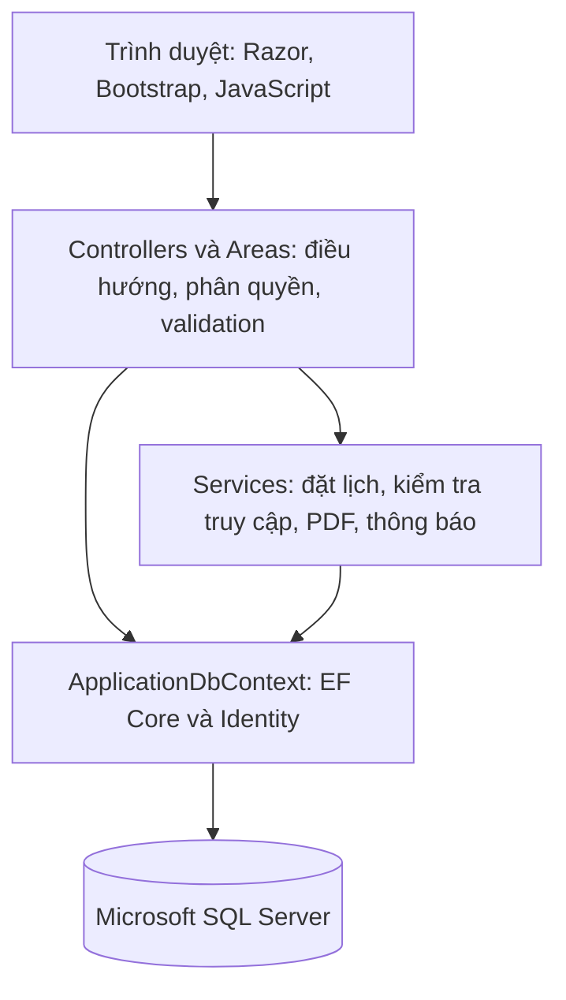
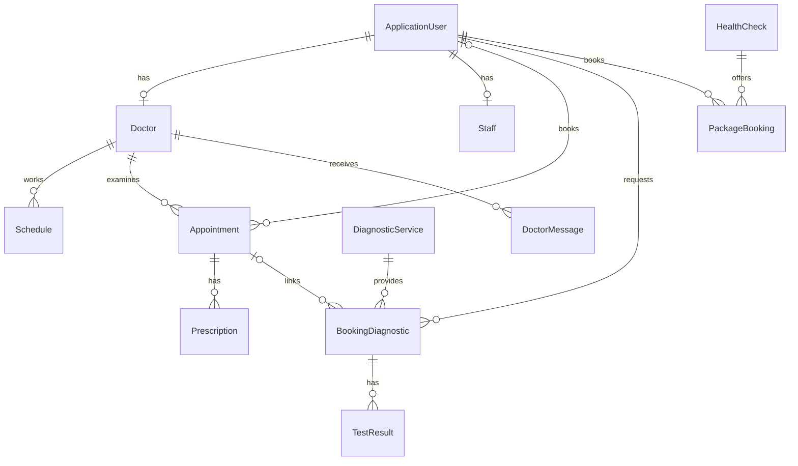

# Phân tích và thiết kế hệ thống quản lý bệnh viện

## Mục tiêu và phạm vi

Hệ thống phục vụ quản lý lịch khám, hồ sơ khám, xét nghiệm và gói khám tại bệnh viện. Sáu nhóm sử dụng gồm khách truy cập, bệnh nhân, bác sĩ, nhân viên tiếp nhận, kỹ thuật viên và quản trị viên. Hướng dẫn thao tác cho từng nhóm nằm trong [README](../README.md).

## Kiến trúc ứng dụng

Ứng dụng xây dựng bằng ASP.NET Core MVC (.NET 8), Entity Framework Core 8 và Microsoft SQL Server. Razor Views dựng HTML trên máy chủ; giao diện sử dụng Bootstrap và JavaScript. ASP.NET Core Identity quản lý tài khoản, vai trò và phiên đăng nhập.

Controllers kiểm tra dữ liệu đầu vào bằng ViewModel. Các nghiệp vụ dùng chung được tổ chức trong Services. EF Core ánh xạ entity, quan hệ, chỉ mục và giao dịch sang SQL Server. Chức năng được chia thành khu vực công khai và các Areas theo vai trò.

| Thành phần | Trách nhiệm |
|---|---|
| `Controllers`, `Views` | Trang công khai, tài khoản, đăng ký dịch vụ và hồ sơ cá nhân |
| `Areas/Admin` | Quản trị danh mục, tài khoản, ca làm việc và điều phối |
| `Areas/Doctor` | Lịch bác sĩ, khám, kê đơn và thông báo |
| `Areas/Diagnostic` | Tiếp nhận xét nghiệm và trả kết quả |
| `Areas/Staff` | Lịch khám hôm nay và tiếp nhận |
| `Models`, `Models/ViewModels` | Entity và dữ liệu biểu mẫu |
| `Data`, `Migrations` | Cấu hình EF Core, khởi tạo dữ liệu và phiên bản schema |
| `Services` | Nghiệp vụ đặt lịch, phân quyền hồ sơ, xuất PDF và gửi thông báo |
| `wwwroot` | CSS, JavaScript, hình ảnh và thư viện giao diện |
| `App_Data` | Font PDF và tệp nghiệp vụ không được phục vụ công khai |

## Các quan hệ dữ liệu chính

`Appointment.PatientId` có thể để trống để hỗ trợ khách đặt khám không cần tài khoản. Phiếu xét nghiệm và gói khám yêu cầu tài khoản. Giá dịch vụ và đơn vị tiền được lưu trên phiếu tại thời điểm đặt để giữ thông tin khi danh mục thay đổi.

## Phân quyền

| Vai trò | Phạm vi nghiệp vụ |
|---|---|
| Khách | Xem danh mục, tin tức, đặt khám; truy cập phiếu khách bằng đường dẫn có token riêng |
| Patient | Quản lý thông tin cá nhân, đăng ký dịch vụ, xem và hủy phiếu của mình theo điều kiện |
| Doctor | Xem lịch của mình, xác nhận/hủy lịch được phân công, khám và kê đơn |
| Staff | Xem lịch khám, tiếp nhận lịch hẹn và gói khám, ghi nhận tiền gói khám |
| Diagnostic | Quản lý danh mục xét nghiệm, tiếp nhận phiếu, cập nhật thanh toán và trả kết quả |
| Admin | Quản lý tài khoản, danh mục, lịch làm việc, điều phối và thống kê |

Kiểm tra quyền được thực hiện tại máy chủ cho cả xem và ghi dữ liệu. Bác sĩ chỉ kê đơn cho lịch của mình; tài khoản bệnh nhân chỉ đọc hồ sơ của mình. Nhân viên tiếp nhận không có quyền đọc kết quả xét nghiệm. Thay đổi vai trò hoặc khóa tài khoản làm mất hiệu lực phiên đăng nhập cũ.

## Quy tắc nghiệp vụ

- **Lịch khám:** khung giờ phải thuộc ca bác sĩ, chưa đến giờ, trong 90 ngày và còn công suất. Giao dịch đặt lịch dùng khóa và chỉ mục để ngăn hai yêu cầu chiếm cùng một khung giờ. Số thứ tự đã cấp được giữ lại khi hủy.
- **Ca làm việc:** mỗi bác sĩ có một ca cho mỗi thứ trong tuần. Sửa hoặc xóa ca áp dụng cho lượt đặt mới; lịch đã đặt cần được điều phối riêng.
- **Trạng thái:** `Pending → Confirmed → Completed`. Phiếu đang chờ hoặc đã xác nhận có thể chuyển sang `Cancelled` theo điều kiện của phân hệ. Chỉ kê đơn hoặc trả kết quả khi đã xác nhận.
- **Cập nhật đồng thời:** các phiếu sử dụng `rowversion`. Yêu cầu dùng phiên bản cũ bị từ chối, người dùng cần tải lại dữ liệu.
- **Hồ sơ:** đơn thuốc được lưu cùng thao tác hoàn tất khám. Tệp kết quả phải là PDF hợp lệ, tối đa 5 MB, lưu ngoài thư mục công khai và tải qua kiểm tra quyền.
- **Thu tiền:** phiếu gói khám khởi tạo số tiền đã thu bằng 0; nhân viên cập nhật theo thực thu. Chọn mức cọc không tự ghi nhận thanh toán. Hủy phiếu không tự ghi nhận đã hoàn tiền.
- **Dữ liệu liên quan:** không xóa dây chuyền các hồ sơ nghiệp vụ; tài khoản hoặc bác sĩ đã có hồ sơ có thể cần khóa thay vì xóa.
- **Thời gian và tiền tệ:** lịch sử dụng UTC+7. Phiếu lưu đơn vị tiền riêng; thống kê tiền được nhóm theo đơn vị, không cộng các loại tiền khác nhau.

## Tài liệu liên quan

- [Cấu trúc mã nguồn web](../HospitalManagement.Web/README.md).
- [Phạm vi và cách chạy kiểm thử](../HospitalManagement.Tests/README.md).
- [Tiện ích khởi tạo và kiểm tra](../scripts/README.md).
- [Công cụ EF Core](../.config/README.md).
- [Schema SQL Server](../database-schema.sql).
